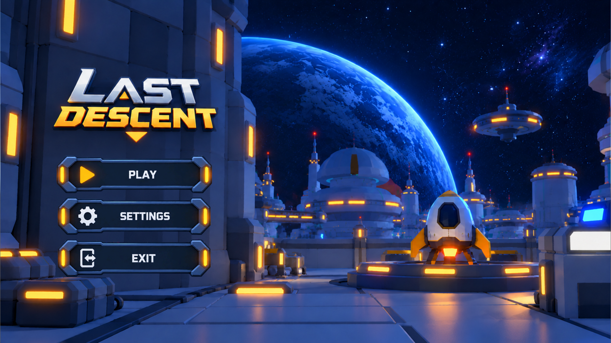
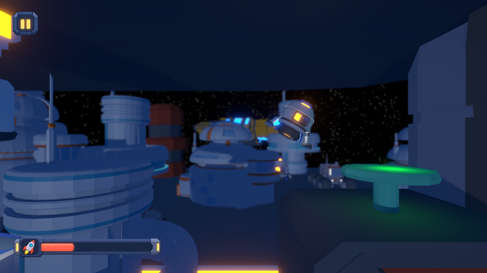
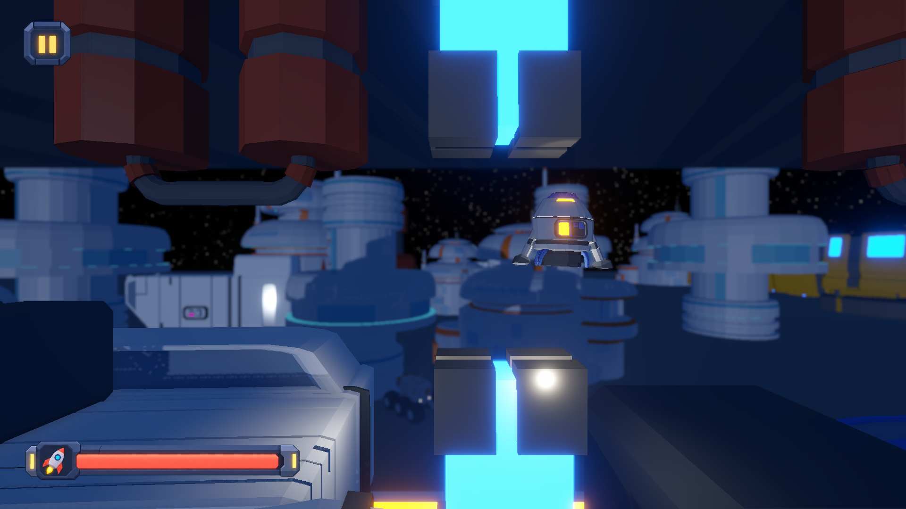
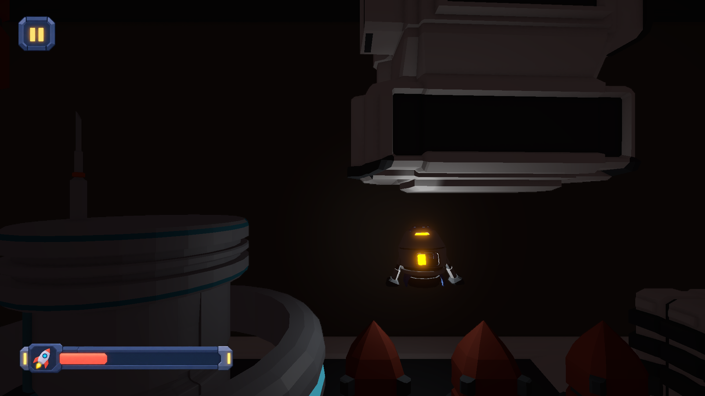

# Last Descent

A 3D Unity sci-fi platformer set in a futuristic space colony. Explore neon-lit habitats, move between elevated platforms, and navigate darker industrial areas.

[▶ Watch or download the gameplay demo](https://github.com/shaahinnn/Last-Descent/releases/download/demo-v1.0/Last.Descent.mp4)

## Gameplay systems

- 3D movement and platforming
- Hazards and environmental navigation
- Gameplay UI and player feedback
- Low-poly sci-fi environments

## Screenshots

### Title screen

### Exploring the colony

### Neon-lit platforming area

### Dark industrial area

## Open the project

1. Clone or download this repository.
2. Open the project folder in Unity Hub.
3. Use the Unity Editor version listed in `ProjectSettings/ProjectVersion.txt`.